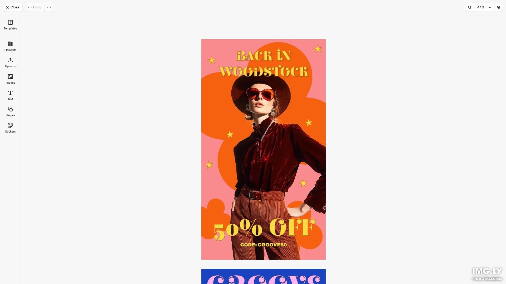

# Premium Templates Editor Demo

Add custom premium templates as an asset source in CE.SDK's design editor. The templates ship with the CE.SDK assets and are listed in a gallery and in the templates dock, ready for users to apply with a single click. Built with [CE.SDK](https://img.ly/creative-sdk) by [IMG.LY](https://img.ly), runs entirely in the browser with no server dependencies.



## Getting Started

### Clone the Repository

```bash
git clone https://github.com/imgly/demo-premium-templates-react-web.git
cd demo-premium-templates-react-web
```

### Install Dependencies

```bash
npm install
```

### Download Assets

CE.SDK requires engine assets (fonts, icons, UI elements) served from your `public/` directory.

```bash
curl -O https://cdn.img.ly/packages/imgly/cesdk-js/$UBQ_VERSION$/imgly-assets.zip
unzip imgly-assets.zip -d public/
rm imgly-assets.zip
```

### Run the Development Server

```bash
npm run dev
```

Open `http://localhost:5173` in your browser.

## Adding Premium Templates

The key feature of this demo is adding premium templates as an asset source. One editor is created when the page loads and kept for the whole visit: the gallery lists the templates from its `PremiumTemplatesAssetSource`, and every template opens in it. The gallery and the editor therefore share one catalogue and one loader, and the engine loads only once.

### Template Configuration

```typescript
import { PremiumTemplatesAssetSource } from '@cesdk/cesdk-js/plugins';

// In the editor's init: add the premium templates and list one category
await cesdk.addPlugin(
  new PremiumTemplatesAssetSource({ include: ['ly.img.templates.premium.*'] })
);
const { assets } = await cesdk.engine.asset.findAssets(
  'ly.img.templates.premium',
  { groups: ['e-commerce'], page: 0, perPage: 9999 }
);

// When the visitor picks a template: open it through the same asset source
await cesdk.engine.asset.apply('ly.img.templates.premium', assets[0]);
```

The plugin reads `ly.img.templates.premium/content.json` under your `baseURL`, or from the IMG.LY CDN when no `baseURL` is set.

### How It Works

1. **Start the Editor** - `App.tsx` mounts one editor and hides it while the gallery shows
2. **List Templates** - The editor adds the premium templates plugin and lists each category for the gallery; the templates also appear in its templates dock
3. **Open a Template** - `openPremiumTemplate` closes the panels the last template left open, then applies the template through the asset source, which loads its scene archive with a fresh undo history
4. **Close** - The close button hides the editor again; the next template replaces the scene

If the editor cannot start, the templates cannot be listed, or a template cannot be opened, the demo says so instead of showing an empty gallery.

### Adding Templates Programmatically

```typescript
// Add a local asset source for templates
engine.asset.addLocalSource('my.templates', [], async (asset) => {
  // Load the template archive when applied
  await engine.scene.load(asset.meta.uri);
  return undefined;
});

// Add a template to the source
engine.asset.addAssetToSource('my.templates', {
  id: 'template-1',
  label: { en: 'My Template' },
  groups: ['category/business'],
  meta: {
    uri: 'https://example.com/templates/business-card.archive',
    thumbUri: 'https://example.com/templates/business-card-thumb.png'
  }
});

// Register in the templates library
cesdk.ui.updateAssetLibraryEntry('ly.img.templates', {
  sourceIds: ({ currentIds }) => [...currentIds, 'my.templates']
});
```

### Template Archive Format

Templates use the `.archive` format which bundles:

- Scene JSON with block definitions
- All referenced images and assets
- Font files used in the design

See [Creating Archives](https://img.ly/docs/cesdk/web/guides/archives/) for creating your own templates.

## Configuration

### Loading Content

Load content into the editor using one of these methods:

```typescript
// Create a blank design canvas
await cesdk.createDesignScene();

// Load from a template archive
await cesdk.load('https://example.com/template.zip');

// Load from a scene file
await cesdk.load('https://example.com/scene.json');

// Load from an image
await cesdk.createFromImage('https://example.com/image.jpg');
```

See [Open the Editor](https://img.ly/docs/cesdk/web/guides/open-editor/) for all loading methods.

### Theming

```typescript
cesdk.ui.setTheme('dark'); // 'light' | 'dark' | 'system'
```

See [Theming](https://img.ly/docs/cesdk/web/ui-styling/theming/) for custom color schemes and styling.

## Architecture

```
src/
├── app/                          # Demo application
├── imgly/
│   ├── config/
│   │   ├── actions.ts                # Export/import actions
│   │   ├── features.ts               # Feature toggles
│   │   ├── i18n.ts                   # Translations
│   │   ├── plugin.ts                 # Main configuration plugin
│   │   ├── settings.ts               # Engine settings
│   │   └── ui/
│   │       ├── canvas.ts                 # Canvas configuration
│   │       ├── components.ts             # Custom component registration
│   │       ├── dock.ts                   # Dock layout configuration
│   │       ├── index.ts                  # Combines UI customization exports
│   │       ├── inspectorBar.ts           # Inspector bar layout
│   │       ├── navigationBar.ts          # Navigation bar layout
│   │       └── panel.ts                  # Panel configuration
│   ├── index.ts                  # Editor initialization function
│   └── premium-templates.ts      # List and open the premium templates
└── index.tsx                 # Application entry point
```

## Key Capabilities

- **Premium Templates** - Add custom templates from your CDN
- **Template Categories** - Organize templates with groups and labels
- **Text Editing** - Typography with fonts, styles, and effects
- **Image Placement** - Add, crop, and arrange images
- **Shapes & Graphics** - Vector shapes and design elements
- **Multi-Page** - Create multi-page documents
- **Export** - PNG, JPEG, PDF with quality controls

## Prerequisites

- **Node.js v22+** with npm – [Download](https://nodejs.org/)
- **Supported browsers** – Chrome 114+, Edge 114+, Firefox 115+, Safari 15.6+

## Troubleshooting

| Issue                               | Solution                                                                     |
| ----------------------------------- | ---------------------------------------------------------------------------- |
| "The editor could not start"        | Verify assets are accessible at `baseURL` and the license key is valid       |
| "The templates could not be loaded" | Check that `ly.img.templates.premium/content.json` is served under `baseURL` |
| Watermark appears                   | Add your license key                                                         |

## Documentation

For complete integration guides and API reference, visit the [Custom Asset Sources Documentation](https://img.ly/docs/cesdk/web/integrations/custom-asset-sources/).

---

<p align="center">Built with <a href="https://img.ly/creative-sdk?utm_source=github&utm_medium=project&utm_campaign=demo-premium-templates">CE.SDK</a> by <a href="https://img.ly?utm_source=github&utm_medium=project&utm_campaign=demo-premium-templates">IMG.LY</a></p>
